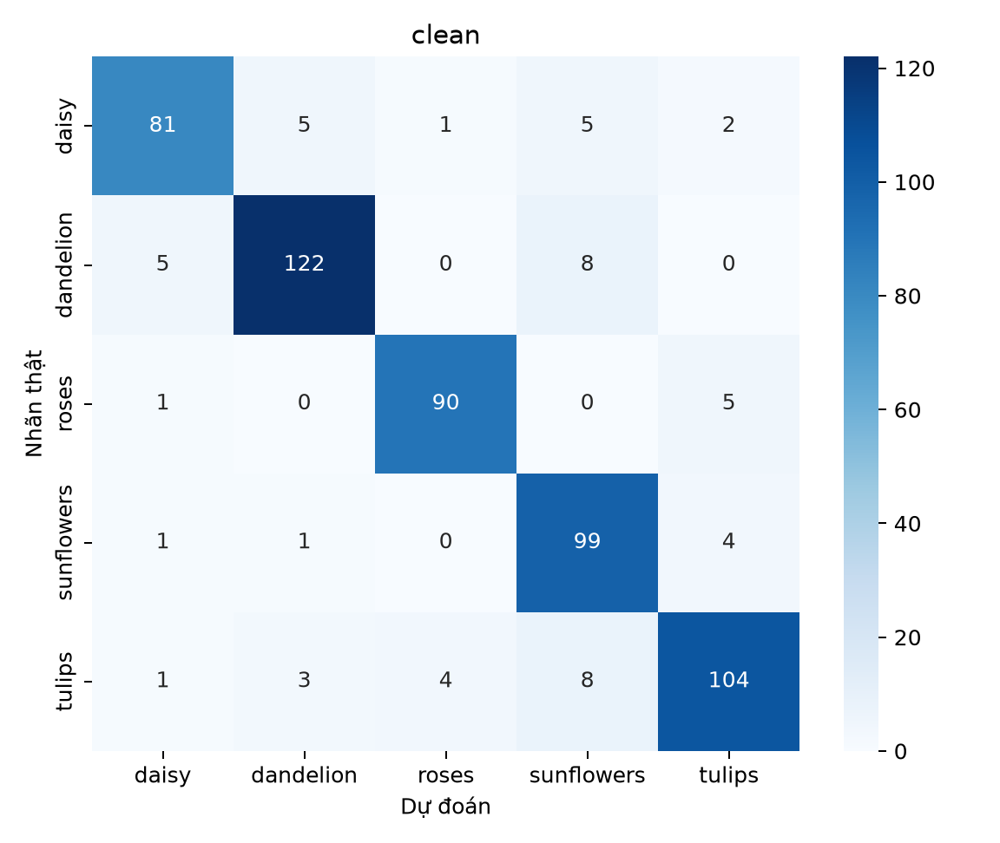

# Nhận diện hoa dưới ảnh suy giảm

Bài tập lớn Xử lý ảnh: khảo sát tác động của thiếu sáng, nhiễu, mờ và lệch màu đến nhận diện năm loại hoa. Các kỹ thuật xử lý ảnh cổ điển được so sánh bằng chất lượng ảnh và kết quả phân loại của cùng một MobileNetV2.

[Demo Streamlit](https://flower-image-restoration-cnn-td.streamlit.app/)

## Báo cáo và thuyết trình

- [Báo cáo Word](docs/REPORT_REVISED.docx)
- [Báo cáo PDF](docs/REPORT_REVISED.pdf)
- [Slide thuyết trình](docs/SLIDES_REVISED.pptx)
- [Lời thuyết trình và giải thích kết quả](docs/LOI_THUYET_TRINH_VA_GIAI_THICH_KET_QUA.docx)
- [Bảng phân công](docs/ASSIGNMENT_FINAL.xlsx)

## Dữ liệu và phương pháp

Bộ TensorFlow Flowers gồm 3.670 ảnh thuộc năm lớp: `daisy` (633), `dandelion` (898), `roses` (641), `sunflowers` (699), `tulips` (799).

| Tập | Số ảnh | Vai trò |
|---|---:|---|
| Train | 2.571 | Huấn luyện MobileNetV2 |
| Validation | 549 | Chọn tham số xử lý ảnh |
| Test | 550 | Đánh giá cuối |

Các ảnh trùng SHA-256 được giữ trong cùng một tập. Ảnh được chuyển RGB và letterbox về 224×224; bước chuẩn hóa MobileNetV2 nằm trong model. Tham số phục hồi được chọn trên Validation rồi khóa trước khi đánh giá Test.

| Suy giảm | Phương pháp so sánh |
|---|---|
| Thiếu sáng | Gamma correction, CLAHE |
| Nhiễu Gaussian | Gaussian filter, bilateral filter |
| Nhiễu muối tiêu | Median filter, Gaussian filter |
| Mờ Gaussian | Sharpening, unsharp mask |
| Lệch màu | RGB balance, hiệu chỉnh HSV, hiệu chỉnh Lab |

Mỗi suy giảm có ba mức. Thực nghiệm gồm 1 điều kiện ảnh sạch, 15 điều kiện suy giảm và 33 điều kiện phục hồi: tổng cộng **49 điều kiện**, tương ứng **26.950 dự đoán** trên Test.

## Kết quả chính

MobileNetV2 trên ảnh sạch đạt Accuracy **90,18%** và Macro F1 **90,20%**. Với nhiễu muối tiêu mức mạnh, median filter tăng Macro F1 từ **68,63%** lên **88,69%**. Trong 33 điều kiện phục hồi, 23 điều kiện tăng và 10 điều kiện giảm Macro F1 so với ảnh suy giảm tương ứng.

PSNR và SSIM cao hơn không luôn dẫn đến nhận diện tốt hơn. Kết luận được giới hạn trong năm lớp hoa và các suy giảm tổng hợp đã khảo sát.



Bảng số liệu, dự đoán từng ảnh và kiểm định thống kê nằm trong [results/final](results/final/). [Manifest](results/final/manifest.json) lưu checksum để đối chiếu kết quả với checkpoint và split.

## Cài đặt và chạy

Dùng Python 3.11. Tại thư mục gốc dự án:

```bash
python -m venv .venv
# Windows: .venv\Scripts\activate
# Linux/macOS: source .venv/bin/activate
pip install -r requirements-dev.txt
streamlit run streamlit_app.py
```

Ứng dụng hỗ trợ một ảnh hoặc batch tối đa 20 ảnh JPEG/PNG, hiển thị ảnh trước/sau xử lý, nhãn dự đoán và xác suất. Checkpoint đã có trong `models/`; raw dataset không được đưa lên GitHub.

Để chạy lại thực nghiệm, đặt bộ ảnh tại `data/flower_photos/` theo [hướng dẫn dữ liệu](data/README.md), sau đó chạy:

```bash
python scripts/run_full_pipeline.py --skip-train
# Huấn luyện lại từ đầu:
python scripts/run_full_pipeline.py --retrain
```

Xem thêm [hướng dẫn thực nghiệm](docs/RUN_FULL_49_AND_DEPLOY.md), [thiết kế thực nghiệm](docs/EXPERIMENTS.md) và [thông tin mô hình](docs/MODEL_CARD.md).

## Kiểm tra

```bash
python -m unittest discover -s tests -v
ruff check src app_components streamlit_app.py scripts tests
python scripts/check_notebook.py --require-executed --require-full-run
python scripts/validate_project.py --require-full-run
```

## Cấu trúc

- `BTL_XuLyAnh_NhanDienHoa.ipynb`: notebook trình bày bài làm và kết quả.
- `src/`, `app_components/`, `streamlit_app.py`: xử lý ảnh, mô hình và ứng dụng.
- `configs/`, `splits/`, `models/`: cấu hình, tập dữ liệu đã chia và checkpoint.
- `results/`, `artifacts/training/`, `figures/`: số liệu thực nghiệm và hình minh họa.
- `docs/`: báo cáo, slide, phân công và tài liệu phương pháp.
- `scripts/`, `tests/`: chạy thực nghiệm và kiểm tra.

## Nhóm thực hiện

Nhóm 7 — Giảng viên: ThS. Nguyễn Văn Sơn.

- 24100358 — Nguyễn Tùng Dương
- 24100065 — Trịnh Ngọc Nga
- 24106898 — Trương Việt Thành

Mã nguồn theo [MIT License](LICENSE). Nguồn ảnh minh họa và thông tin tác giả được ghi trong [docs/NGUON_ANH_MINH_HOA.txt](docs/NGUON_ANH_MINH_HOA.txt).
